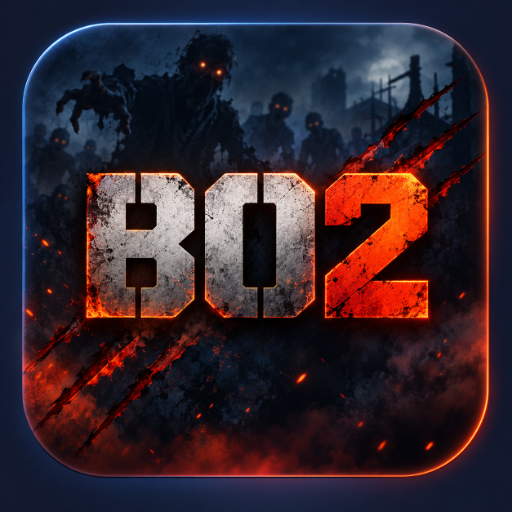

<p align="center">
  
</p>

# BO2 PS5 Mod Menu

A mod menu for **Call of Duty: Black Ops II Zombies** on a jailbroken **PS5**, running on the
native PS5 build of the game (`PPSA34502`, **version 01.010.000** only). It comes as a home-screen
app, **BO2 Mod Installer**, that installs the menu and loads it into the game.

For local/offline play only.

## Download

Get `PPSA99002.zip` from the [latest release](../../releases/latest).

## Requirements

- A jailbroken PS5 running kstuff, with an **ELF loader listening on port 9021**
- A homebrew launcher that runs folder apps, such as ShadowMountPlus
- Black Ops II for PS5, **version 01.010.000** (`PPSA34502`, see below)

### Supported game version

The mod patches the game's Zombies executable at fixed addresses, so it only works with this exact
version of the game:

| | |
|---|---|
| Game | Call of Duty: Black Ops II (PS5) |
| Title ID | `PPSA34502` |
| Content ID | `UP0002-PPSA34502_00-CODBO2GAME000001` |
| Version | **01.010.000** |
| `codzm.elf` SHA-256 | `eae57396807139f5317e096a73a773388b0e12733d0c2998d2246884923163c4` |

The version is the game's `contentVersion` in `sce_sys/param.json`, and also shows in the game's
Information screen on the PS5. Other versions, including the base game 01.000.000 and later updates,
are not supported: the payload won't find the Zombies executable, or refuses to patch it with
*Unknown game version*. Supporting another version means finding the offsets again for its
`codzm.elf`.

## Install

1. Unzip `PPSA99002.zip` and copy the `PPSA99002` folder to your PS5, where your launcher picks up
   folder apps.
2. Open **BO2 Mod Installer** and choose **Install Mod Menu**. This copies the menu script to
   `/data/DeadOps/t6_zm/_clientids.gsc`.

## Play

Each time you play:

1. In **BO2 Mod Installer**, choose **Load Mods (send DeadOps)**.
2. Start Black Ops II and go into Zombies within 5 minutes. A notification says
   *"Mod menu loaded into Zombies"*.
3. In a match, **double-tap melee** (R3 on the default layout) to open the menu.

| Button | Action |
|---|---|
| Double-tap melee (R3) | Open / close the menu |
| D-pad Up / Down | Move through options |
| D-pad Right | Select |
| D-pad Left | Back / close |

## Menu

- **Self:** God Mode, No Clip (hold Jump to fly forward), Third Person, Speed x1/x2/x3, Revive, Suicide
- **Weapons:** Infinite Ammo, Max Ammo, Ray Gun, Ray Gun MK2, War Machine, HAMR, Galil, RPD, AN-94,
  All Perks, Drop All Weapons
- **Zombies:** 50,000 / 500,000 / max points, Kill All Zombies, Skip 5 or 10 Rounds, Freeze Zombies
- **Teleport:** Save Position, Load Position, Teleport Forward, Teleport Up
- **Game:** Turn On Power, Open All Doors, Restart Map, End Game

Some options depend on the map: weapons that don't exist on the current map won't be given, and
Skip Rounds changes the round number without spawning that round's zombies.

## How it works

The PS5 build of Black Ops II can't load the original DeadOps PS4 module, so this project ports
DeadOps' approach to a **payload** that patches the game from outside:

1. **BO2 Mod Installer** (`installer/`) is a native PS5 app. *Install* copies the menu script to
   `/data/DeadOps/t6_zm/`; *Load Mods* sends the DeadOps-PS5 payload to the ELF loader on port 9021.
2. **DeadOps-PS5** (`deadops-ps5/payload/`) compiles `_clientids.gsc` with DeadOps' T6 GSC compiler,
   waits for the Zombies executable, then attaches to it and hooks `DB_FindXAssetHeader`. When the
   game asks for `maps/mp/gametypes_zm/_clientids.gsc`, it gets the compiled menu instead.
3. **The menu** (`installer/assets/_clientids.gsc`) keeps the original script's client-ID logic, so
   the rest of the game is unaffected.

## Troubleshooting

The payload writes each step to **`/data/DeadOps/log.txt`**.

| Message | Meaning |
|---|---|
| *No ELF loader on port 9021* | Send your jailbreak payloads first, then *Load Mods* again. |
| *Timed out waiting for BO2 Zombies* | Zombies wasn't started within 5 minutes; *Load Mods* again. If it happens every time, check that your game is [version 01.010.000](#supported-game-version). |
| *Unknown game version* | Your game isn't [version 01.010.000](#supported-game-version); nothing was patched. |
| *Compile failed: ...* | The menu script has a syntax error. |
| Game error mentioning *script error(s)* | The script calls a function this build of BO2 doesn't have. |

## Editing the menu

The menu is a plain GSC script: `installer/assets/_clientids.gsc` in this repository, installed to
`/data/DeadOps/t6_zm/_clientids.gsc`. The payload compiles that file every time you choose
*Load Mods*, so after editing it on the console you only need to load mods again before starting
Zombies.

BO2 crashes if a script calls a function it doesn't have, so check every edit first:

```bash
python3 deadops-ps5/host/check_gsc.py installer/assets/_clientids.gsc
```

The checker reads the game's real function tables from a decrypted `codzm.elf`
(`deadops-ps5/re/codzm.plain.elf`, extracted from your own game files; not included here).

## Building from source

Builds run on Linux or WSL with `clang-18`, the
[ps5-payload-sdk](https://github.com/ps5-payload-dev/sdk) and `ps5-native-tool` from the
[ps5-native-app-boilerplate](https://github.com/blackbearreloaded/ps5-native-app-boilerplate):

```bash
cd installer
make deadops   # builds the DeadOps-PS5 payload into assets/
make           # builds dist/PPSA99002/
```

See [installer/BUILD.md](installer/BUILD.md) for paths and settings.

## Project layout

| Path | Contents |
|---|---|
| `installer/` | BO2 Mod Installer app: source, app metadata, icon, menu script, build scripts |
| `deadops-ps5/payload/` | DeadOps-PS5 payload and the game hook |
| `deadops-ps5/host/` | PC tools: `check_gsc.py`, a command-line GSC compiler, hook tests |
| `deadops-ps5/source/` | Upstream [DeadOps](https://github.com/ItsJokerZz/DeadOps) source (PS4 module and T6 compiler). Its README describes the PS4 version. |
| `mod_menu/` | Earlier menu drafts and a PC deploy script (superseded by the installer) |
| `tools/` | Fast file (`.ff`) analysis script |

## License

GPL-3.0-or-later; see [COPYING](COPYING). [NOTICE.md](NOTICE.md) lists the parts that come from
other projects and their licenses.

## Credits

- [DeadOps](https://github.com/ItsJokerZz/DeadOps) by ItsJokerZz: the GSC loader this ports to PS5
- [gsc-tool](https://github.com/xensik/gsc-tool) by xensik: the T6 GSC compiler
- [ps5-native-app-boilerplate](https://github.com/blackbearreloaded/ps5-native-app-boilerplate) by
  BlackBearReloaded: native app startup code and build tooling
- [ps5-payload-sdk](https://github.com/ps5-payload-dev/sdk): PS5 payload toolchain

This project is not affiliated with Activision or Sony. No game files are included.
